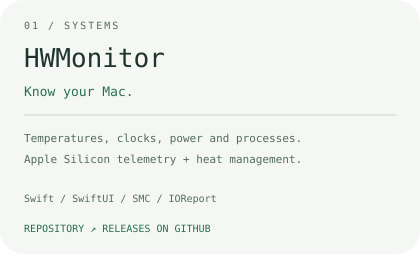
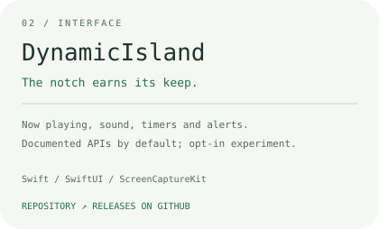
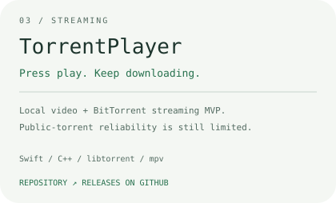
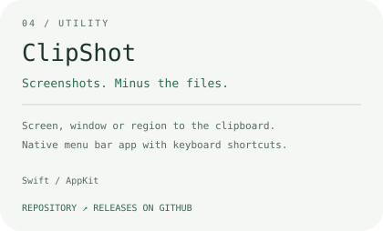

<picture>
  <source media="(max-width: 600px) and (prefers-color-scheme: dark)" srcset="https://raw.githubusercontent.com/gdfaler/gdfaler/profile-assets/assets/profile/island-dark-mobile.svg">
  <source media="(max-width: 600px) and (prefers-color-scheme: light)" srcset="https://raw.githubusercontent.com/gdfaler/gdfaler/profile-assets/assets/profile/island-light-mobile.svg">
  <source media="(prefers-color-scheme: dark)" srcset="https://raw.githubusercontent.com/gdfaler/gdfaler/profile-assets/assets/profile/island-dark.svg">
  <source media="(prefers-color-scheme: light)" srcset="https://raw.githubusercontent.com/gdfaler/gdfaler/profile-assets/assets/profile/island-light.svg">
  
</picture>

# Heya, I'm Egor

**Building things. Breaking things. Understanding things.**

CS student at BMSTU, interested in building things from scratch and figuring out what happens under the hood. I make native macOS apps, experiment with neural networks, and occasionally reinvent things that probably didn't need reinventing.

Currently exploring systems programming, machine learning, and the macOS ecosystem. We'll see what breaks first.

[Public data & text fallback](https://github.com/gdfaler/gdfaler/blob/profile-assets/assets/profile/snapshot.md) · [How this profile works](docs/profile.md)

## Achievements

- **Winner** — City Energy — Into Action hackathon (*«Энергия города — в дело»*)
- **Prize winner** — Moscow Pre-Professional Olympiad for Schoolchildren 2026, Research Track
- **Prize winner** — RTU MIREA Multidisciplinary Olympiad 2026, Computer Science
- **Yandex Lyceum** — Fundamentals of Python Programming (2025–2026)

## Tech Stack

**Swift · Java · Python · C++**  
Native interfaces: **SwiftUI · AppKit** / Systems & graphics: **SMC · IOReport · LWJGL · OpenGL**  
Learning & experiments: **PyTorch · Flask** / Mobile: **Android · Firebase** / Tooling: **CMake · CTest · GitHub Actions**

## Featured Projects

<a href="https://github.com/gdfaler/HWMonitor">
<picture>
  <source media="(prefers-color-scheme: dark)" srcset="https://raw.githubusercontent.com/gdfaler/gdfaler/profile-assets/assets/profile/project-HWMonitor-dark.svg">
  <source media="(prefers-color-scheme: light)" srcset="https://raw.githubusercontent.com/gdfaler/gdfaler/profile-assets/assets/profile/project-HWMonitor-light.svg">
  
</picture>
</a>
<a href="https://github.com/gdfaler/DynamicIsland">
<picture>
  <source media="(prefers-color-scheme: dark)" srcset="https://raw.githubusercontent.com/gdfaler/gdfaler/profile-assets/assets/profile/project-DynamicIsland-dark.svg">
  <source media="(prefers-color-scheme: light)" srcset="https://raw.githubusercontent.com/gdfaler/gdfaler/profile-assets/assets/profile/project-DynamicIsland-light.svg">
  
</picture>
</a>
<a href="https://github.com/gdfaler/TorrentPlayer">
<picture>
  <source media="(prefers-color-scheme: dark)" srcset="https://raw.githubusercontent.com/gdfaler/gdfaler/profile-assets/assets/profile/project-TorrentPlayer-dark.svg">
  <source media="(prefers-color-scheme: light)" srcset="https://raw.githubusercontent.com/gdfaler/gdfaler/profile-assets/assets/profile/project-TorrentPlayer-light.svg">
  
</picture>
</a>
<a href="https://github.com/gdfaler/ClipShot">
<picture>
  <source media="(prefers-color-scheme: dark)" srcset="https://raw.githubusercontent.com/gdfaler/gdfaler/profile-assets/assets/profile/project-ClipShot-dark.svg">
  <source media="(prefers-color-scheme: light)" srcset="https://raw.githubusercontent.com/gdfaler/gdfaler/profile-assets/assets/profile/project-ClipShot-light.svg">
  
</picture>
</a>

Project descriptions &amp; releases — readable without images

- **[HWMonitor](https://github.com/gdfaler/HWMonitor)** — telemetry and heat management for Apple Silicon Macs. Sensor coverage varies by hardware; SMC and IOReport use undocumented interfaces. **Swift · SwiftUI.** [Releases](https://github.com/gdfaler/HWMonitor/releases).
- **[DynamicIsland](https://github.com/gdfaler/DynamicIsland)** — now playing, an audio visualizer, timers and alerts around the MacBook notch. Documented facilities by default; experimental MediaRemote support is opt-in. **Swift · SwiftUI · ScreenCaptureKit · vDSP.** [Releases](https://github.com/gdfaler/DynamicIsland/releases).
- **[TorrentPlayer](https://github.com/gdfaler/TorrentPlayer)** — native macOS video player for local files and BitTorrent streaming. An early MVP: local playback is the most tested path; public-torrent streaming still has reliability limits. Uses third-party libraries. **Swift · AppKit · C++ · libtorrent · mpv.** [Releases](https://github.com/gdfaler/TorrentPlayer/releases).
- **[ClipShot](https://github.com/gdfaler/ClipShot)** — a tiny menu bar app that sends screen, window and region screenshots to the clipboard with keyboard shortcuts. Your desktop has enough PNGs already. **Swift · AppKit.** [Releases](https://github.com/gdfaler/ClipShot/releases).

## Developer Monitor

<picture>
  <source media="(max-width: 600px) and (prefers-color-scheme: dark)" srcset="https://raw.githubusercontent.com/gdfaler/gdfaler/profile-assets/assets/profile/monitor-dark-mobile.svg">
  <source media="(max-width: 600px) and (prefers-color-scheme: light)" srcset="https://raw.githubusercontent.com/gdfaler/gdfaler/profile-assets/assets/profile/monitor-light-mobile.svg">
  <source media="(prefers-color-scheme: dark)" srcset="https://raw.githubusercontent.com/gdfaler/gdfaler/profile-assets/assets/profile/monitor-dark.svg">
  <source media="(prefers-color-scheme: light)" srcset="https://raw.githubusercontent.com/gdfaler/gdfaler/profile-assets/assets/profile/monitor-light.svg">
  
</picture>

Languages count **repositories by GitHub primary language**, not lines of code or proficiency. Activity counts **authored default-branch commits**, not contributions. Downloads count **stable release assets**, not users. CI shows the **latest Actions run**, not an overall health score.

[Exact values & daily activity](https://github.com/gdfaler/gdfaler/blob/profile-assets/assets/profile/snapshot.md) · [Sources, scope & limitations](docs/profile.md)

## My Contribution World

<picture>
  <source media="(prefers-color-scheme: dark)" srcset="https://raw.githubusercontent.com/gdfaler/gdfaler/contribution-world/world-dark.svg">
  <source media="(prefers-color-scheme: light)" srcset="https://raw.githubusercontent.com/gdfaler/gdfaler/contribution-world/world-light.svg">
  
</picture>

One day, one block. A world built by showing up. Inspired by [MineAndCraft](https://github.com/gdfaler/MineAndCraft). [Calendar data](https://github.com/gdfaler/gdfaler/blob/contribution-world/calendar.json).

## More Projects

| Project | What's under the hood |
|---|---|
| [GDF AI](https://github.com/gdfaler/gdf_ai) | A small LLaMA-style transformer built from scratch, with its own tokenizer and web chat. **Python · PyTorch · Flask.** Gotta start somewhere. |
| [MineAndCraft](https://github.com/gdfaler/MineAndCraft) | A voxel sandbox with a custom engine, procedural terrain, caves and chunk streaming. **Java · LWJGL · OpenGL.** Mojang, please don't sue. |
| [Five Nights On Your Own](https://github.com/gdfaler/FiveNightOnYourOwn) | Cameras, doors, lights and power in an ASCII survival-horror game. Freddy is literally the letter F. **Java · JavaFX.** |
| [Vneurochka](https://github.com/gdfaler/vneurochka2025) | School clubs, accounts, search and chat; built with a teammate for Potential 2025. **Java · Android · Firebase.** |
| [arraylib](https://github.com/gdfaler/arraylib) | Array sums, averages and medians, with unit/integration tests and CI. **C++17 · CMake · CTest.** Overkill? Absolutely. |

## One more process

<picture>
  <source media="(max-width: 600px) and (prefers-color-scheme: dark)" srcset="https://raw.githubusercontent.com/gdfaler/gdfaler/profile-assets/assets/profile/terminal-dark-mobile.svg">
  <source media="(max-width: 600px) and (prefers-color-scheme: light)" srcset="https://raw.githubusercontent.com/gdfaler/gdfaler/profile-assets/assets/profile/terminal-light-mobile.svg">
  <source media="(prefers-color-scheme: dark)" srcset="https://raw.githubusercontent.com/gdfaler/gdfaler/profile-assets/assets/profile/terminal-dark.svg">
  <source media="(prefers-color-scheme: light)" srcset="https://raw.githubusercontent.com/gdfaler/gdfaler/profile-assets/assets/profile/terminal-light.svg">
  
</picture>

`whoami → Egor` · `life.sh → learn / build / break / repeat` · `[WARN] sleep: dependency not found`

---

`loop. fail. upgrade. repeat.`

Custom SVGs, public GitHub data, no third-party stats widgets. This review uses a manually seeded, dated snapshot. Scheduled refresh is available only after the workflow reaches the default branch; nothing auto-refreshes before merge.
