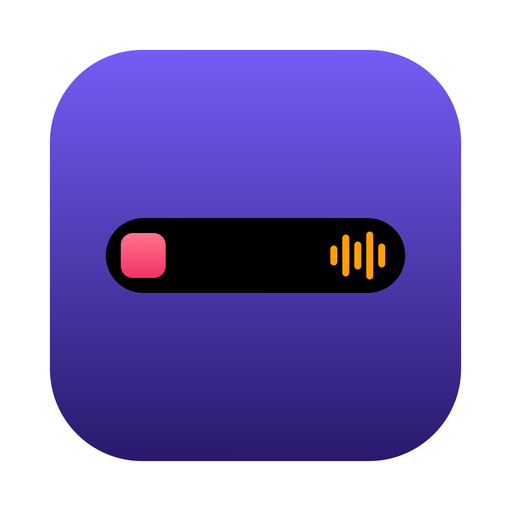
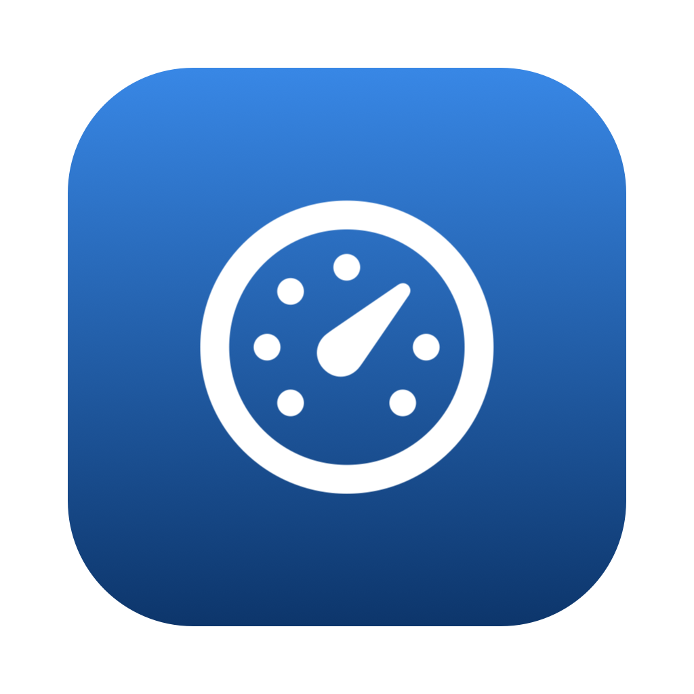
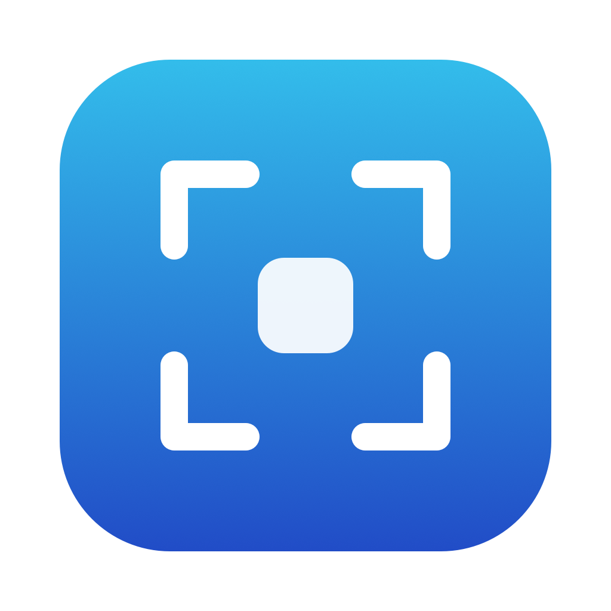

# Heya, I'm Egor

CS student at BMSTU. I build macOS apps and explore systems, graphics and machine learning.

## Projects

  <a href="https://github.com/gdfaler/DynamicIsland"> <strong>DynamicIsland</strong></a> 
  Music, timers and alerts around the MacBook notch.

  <a href="https://github.com/gdfaler/HWMonitor"> <strong>HWMonitor</strong></a> 
  Temperatures, power and processes on Apple Silicon Macs.

  <a href="https://github.com/gdfaler/ClipShot"> <strong>ClipShot</strong></a> 
  Screen, window or region screenshots, straight to the clipboard.

  <a href="https://github.com/gdfaler/TorrentPlayer"><strong>TorrentPlayer</strong></a> 
  Local video playback and BitTorrent streaming. <em>Early MVP.</em>

Also: [a Java voxel engine](https://github.com/gdfaler/MineAndCraft) and [a small transformer from scratch](https://github.com/gdfaler/gdf_ai).

<picture>
  <source media="(prefers-color-scheme: dark)" srcset="https://raw.githubusercontent.com/gdfaler/gdfaler/contribution-world/world-dark.svg">
  <source media="(prefers-color-scheme: light)" srcset="https://raw.githubusercontent.com/gdfaler/gdfaler/contribution-world/world-light.svg">
  
</picture>
