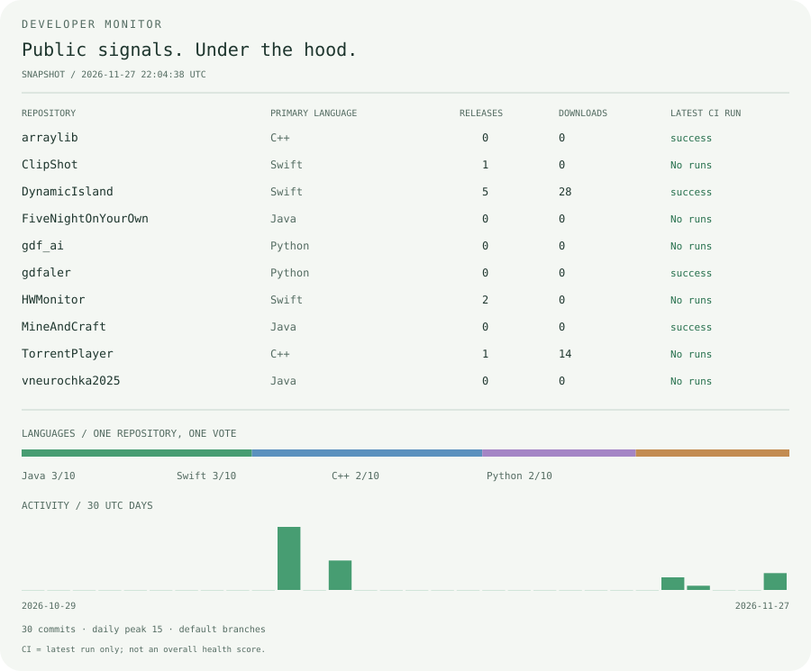

<picture>
  <source media="(max-width: 600px) and (prefers-color-scheme: dark)" srcset="https://raw.githubusercontent.com/gdfaler/gdfaler/profile-assets/assets/profile/island-dark-mobile.svg">
  <source media="(max-width: 600px) and (prefers-color-scheme: light)" srcset="https://raw.githubusercontent.com/gdfaler/gdfaler/profile-assets/assets/profile/island-light-mobile.svg">
  <source media="(prefers-color-scheme: dark)" srcset="https://raw.githubusercontent.com/gdfaler/gdfaler/profile-assets/assets/profile/island-dark.svg">
  <source media="(prefers-color-scheme: light)" srcset="https://raw.githubusercontent.com/gdfaler/gdfaler/profile-assets/assets/profile/island-light.svg">
  
</picture>

# Heya, I'm Egor

CS student at BMSTU. I build native macOS apps, explore systems and ML, and occasionally reinvent things that probably didn't need reinventing.

**Swift · Java · Python · C++**

Achievements

- **Winner** — City Energy — Into Action hackathon (*«Энергия города — в дело»*)
- **Prize winner** — Moscow Pre-Professional Olympiad for Schoolchildren 2026, Research Track
- **Prize winner** — RTU MIREA Multidisciplinary Olympiad 2026, Computer Science
- **Yandex Lyceum** — Fundamentals of Python Programming (2025–2026)

## Selected work

| Project | What it does |
|---|---|
| **[HWMonitor](https://github.com/gdfaler/HWMonitor)** | Apple Silicon telemetry and heat management. [Releases](https://github.com/gdfaler/HWMonitor/releases) |
| **[DynamicIsland](https://github.com/gdfaler/DynamicIsland)** | Music, timers and alerts around the MacBook notch. [Releases](https://github.com/gdfaler/DynamicIsland/releases) |
| **[TorrentPlayer](https://github.com/gdfaler/TorrentPlayer)** | Local video + BitTorrent streaming. Early MVP. [Releases](https://github.com/gdfaler/TorrentPlayer/releases) |
| **[ClipShot](https://github.com/gdfaler/ClipShot)** | Screenshots straight to the clipboard. [Releases](https://github.com/gdfaler/ClipShot/releases) |

More projects &amp; stack

| Project | What's under the hood |
|---|---|
| [GDF AI](https://github.com/gdfaler/gdf_ai) | A small LLaMA-style transformer built from scratch, with its own tokenizer and web chat. **Python · PyTorch · Flask.** Gotta start somewhere. |
| [MineAndCraft](https://github.com/gdfaler/MineAndCraft) | A voxel sandbox with a custom engine, procedural terrain, caves and chunk streaming. **Java · LWJGL · OpenGL.** Mojang, please don't sue. |
| [Five Nights On Your Own](https://github.com/gdfaler/FiveNightOnYourOwn) | Cameras, doors, lights and power in an ASCII survival-horror game. Freddy is literally the letter F. **Java · JavaFX.** |
| [Vneurochka](https://github.com/gdfaler/vneurochka2025) | School clubs, accounts, search and chat; built with a teammate for Potential 2025. **Java · Android · Firebase.** |
| [arraylib](https://github.com/gdfaler/arraylib) | Array sums, averages and medians, with unit/integration tests and CI. **C++17 · CMake · CTest.** Overkill? Absolutely. |

**SwiftUI · AppKit · ScreenCaptureKit · vDSP · SMC · IOReport · LWJGL · OpenGL · PyTorch · Flask · Android · Firebase · CMake · CTest · GitHub Actions**

HWMonitor sensor coverage varies by Mac; it uses undocumented SMC/IOReport interfaces. DynamicIsland uses documented facilities by default, with opt-in experimental MediaRemote support. TorrentPlayer uses libtorrent/mpv and other third-party libraries; public-torrent streaming still has reliability limits.

<picture>
  <source media="(max-width: 600px) and (prefers-color-scheme: dark)" srcset="https://raw.githubusercontent.com/gdfaler/gdfaler/profile-assets/assets/profile/monitor-dark-mobile.svg">
  <source media="(max-width: 600px) and (prefers-color-scheme: light)" srcset="https://raw.githubusercontent.com/gdfaler/gdfaler/profile-assets/assets/profile/monitor-light-mobile.svg">
  <source media="(prefers-color-scheme: dark)" srcset="https://raw.githubusercontent.com/gdfaler/gdfaler/profile-assets/assets/profile/monitor-dark.svg">
  <source media="(prefers-color-scheme: light)" srcset="https://raw.githubusercontent.com/gdfaler/gdfaler/profile-assets/assets/profile/monitor-light.svg">
  
</picture>

Languages = repositories by primary language. Activity = authored default-branch commits. [Data & text version](https://github.com/gdfaler/gdfaler/blob/profile-assets/assets/profile/snapshot.md) · [Methodology](docs/profile.md). Dated preview; scheduled refresh requires merge.

<picture>
  <source media="(prefers-color-scheme: dark)" srcset="https://raw.githubusercontent.com/gdfaler/gdfaler/contribution-world/world-dark.svg">
  <source media="(prefers-color-scheme: light)" srcset="https://raw.githubusercontent.com/gdfaler/gdfaler/contribution-world/world-light.svg">
  
</picture>

One more process…

<picture>
  <source media="(max-width: 600px) and (prefers-color-scheme: dark)" srcset="https://raw.githubusercontent.com/gdfaler/gdfaler/profile-assets/assets/profile/terminal-dark-mobile.svg">
  <source media="(max-width: 600px) and (prefers-color-scheme: light)" srcset="https://raw.githubusercontent.com/gdfaler/gdfaler/profile-assets/assets/profile/terminal-light-mobile.svg">
  <source media="(prefers-color-scheme: dark)" srcset="https://raw.githubusercontent.com/gdfaler/gdfaler/profile-assets/assets/profile/terminal-dark.svg">
  <source media="(prefers-color-scheme: light)" srcset="https://raw.githubusercontent.com/gdfaler/gdfaler/profile-assets/assets/profile/terminal-light.svg">
  
</picture>

`whoami → Egor` · `life.sh → learn / build / break / repeat` · `[WARN] sleep: dependency not found`

`loop. fail. upgrade. repeat.`
