<picture>
  <source media="(max-width: 600px) and (prefers-color-scheme: dark)" srcset="assets/showcase/showcase-dark-mobile.svg">
  <source media="(max-width: 600px) and (prefers-color-scheme: light)" srcset="assets/showcase/showcase-light-mobile.svg">
  <source media="(prefers-color-scheme: dark)" srcset="assets/showcase/showcase-dark.svg">
  <source media="(prefers-color-scheme: light)" srcset="assets/showcase/showcase-light.svg">
  
</picture>

  <a href="https://github.com/gdfaler/DynamicIsland"><picture><source media="(prefers-color-scheme: dark)" srcset="assets/showcase/link-dynamicisland-dark.svg"></picture></a>
  <a href="https://github.com/gdfaler/HWMonitor"><picture><source media="(prefers-color-scheme: dark)" srcset="assets/showcase/link-hwmonitor-dark.svg"></picture></a>
  <a href="https://github.com/gdfaler/TorrentPlayer"><picture><source media="(prefers-color-scheme: dark)" srcset="assets/showcase/link-torrentplayer-dark.svg"></picture></a>
  <a href="https://github.com/gdfaler/ClipShot"><picture><source media="(prefers-color-scheme: dark)" srcset="assets/showcase/link-clipshot-dark.svg"></picture></a>

About &amp; projects

I'm Egor, a CS student at BMSTU. I build native macOS apps and explore systems, graphics and machine learning with Swift, Java, Python and C++.

- **[DynamicIsland](https://github.com/gdfaler/DynamicIsland)** — music, timers and alerts around the MacBook notch.
- **[HWMonitor](https://github.com/gdfaler/HWMonitor)** — temperatures, power and processes on Apple Silicon Macs.
- **[TorrentPlayer](https://github.com/gdfaler/TorrentPlayer)** — local video playback and BitTorrent streaming. Early MVP.
- **[ClipShot](https://github.com/gdfaler/ClipShot)** — screen, window or region screenshots, straight to the clipboard.

Also: [a Java voxel engine](https://github.com/gdfaler/MineAndCraft) and [a small transformer from scratch](https://github.com/gdfaler/gdf_ai).

Contribution World

<picture>
  <source media="(prefers-color-scheme: dark)" srcset="https://raw.githubusercontent.com/gdfaler/gdfaler/contribution-world/world-dark.svg">
  <source media="(prefers-color-scheme: light)" srcset="https://raw.githubusercontent.com/gdfaler/gdfaler/contribution-world/world-light.svg">
  
</picture>

