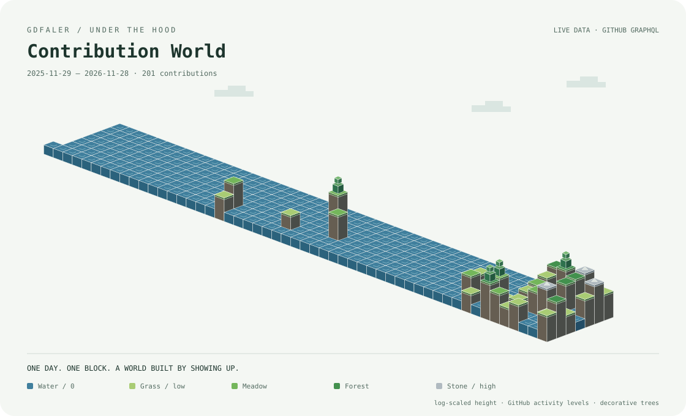

<h1 align="center">Heya, I'm Egor.</h1>

  CS student at <strong>BMSTU</strong>

  My Mac has a notch and no fan.   <em>Apparently, I took both personally.</em>

### So I made these

🎵 **[DynamicIsland](https://github.com/gdfaler/DynamicIsland)** · `SwiftUI` Music, timers and alerts where there used to be a black rectangle.

🌡️ **[HWMonitor](https://github.com/gdfaler/HWMonitor)** · `SwiftUI` My Mac was getting hot. I wanted to know who to blame.

🎬 **[TorrentPlayer](https://github.com/gdfaler/TorrentPlayer)** · `Swift · C++` A video player for people who click Play before the download is done. Early MVP.

📸 **[ClipShot](https://github.com/gdfaler/ClipShot)** · `AppKit` Take a screenshot. Put it on the clipboard. Leave my desktop alone.

Also: 🧱 [a voxel engine](https://github.com/gdfaler/MineAndCraft) and 🧠 [a tiny transformer](https://github.com/gdfaler/gdf_ai). Staying on topic is a work in progress.

 

<picture>
  <source media="(prefers-color-scheme: dark)" srcset="https://raw.githubusercontent.com/gdfaler/gdfaler/contribution-world/world-dark.svg">
  <source media="(prefers-color-scheme: light)" srcset="https://raw.githubusercontent.com/gdfaler/gdfaler/contribution-world/world-light.svg">
  
</picture>
